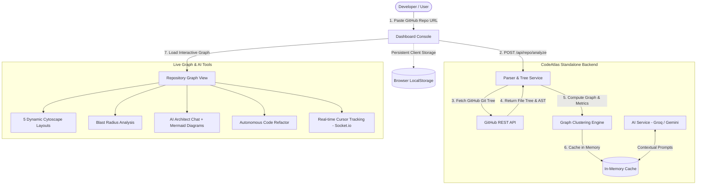
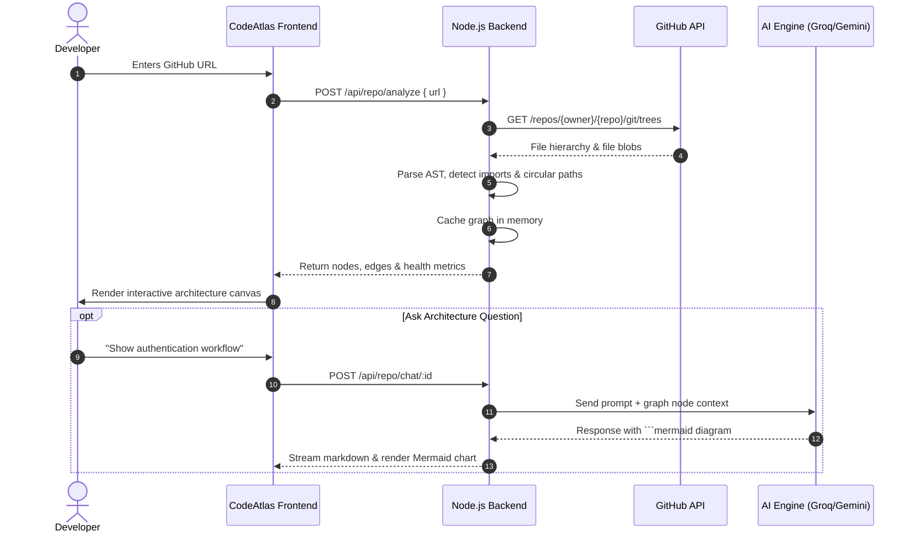

<div align="center">

# 🌐 CODEATLAS
### *AI-Powered Repository Intelligence & Interactive Architecture Mapping*

[](https://opensource.org/licenses/MIT)
[](#)
[](#)
[](#)
[](#)

<p align="center">
  <b>Turn complex GitHub repositories into interactive, living dependency maps. Predict blast radius before changing code, chat with an AI architect, and refactor files on the fly.</b>
</p>

> *"The best way to predict the future is to create it. Write clean code, dream big, and never stop building."*  
> — **Created with dedication by [Sadashiv Gawade](https://github.com/SadashivGawade321)**

</div>

---

## 🌟 Why CodeAtlas?

When inheriting unfamiliar codebases or refactoring large systems, developers often struggle to visualize how files, modules, and components interact. **CodeAtlas** solves this with zero setup:
- 🚀 **Zero Barrier to Entry**: No signup, no login walls, and no database configuration required.
- ⚡ **Instant Architecture Visualization**: Paste any public GitHub repo URL and generate interactive dependency graphs in seconds.
- 🎯 **Predict Blast Radius**: Pinpoint every downstream dependency that could break before committing a change.
- 🧠 **AI-Powered Insights**: Chat with an AI repository architect, trigger automated code reviews, and generate sequence diagrams on demand.

---

## 🏗️ Architecture & Workflow



---

## 🚀 Key Features

### 1. 🗺️ Interactive Graph Explorer
* Powered by **Cytoscape.js** with 5 dynamic layout modes: *Force-Directed (CoSE), Grid, Circle, Hierarchical (Breadthfirst), and Concentric*.
* Color-code nodes by folder, architectural layer, or churn rate.
* Search, zoom, pan, and isolate subgraphs with smooth spring animations.

### 2. 💥 Multi-Hop Blast Radius & Risk Hotspots
* Click any file node to immediately highlight its direct imports and downstream dependents.
* Calculate health scores based on coupling density, isolated modules, and circular dependencies.

### 3. 🤖 AI Architect Chat & Mermaid Diagrams
* Context-aware AI assistant answers structural questions about your codebase.
* Automatically renders responsive flowcharts and sequence diagrams directly in chat via Mermaid.js.

### 4. 🛠️ Autonomous Refactoring & Code Review
* Select any source file to inspect issues (security risks, performance bottlenecks, code smells).
* One-click autonomous refactor generates clean, modernized code comparisons with side-by-side diffs.

### 5. 👥 Multiplayer Real-Time Collaboration
* Connected developers can collaborate in the same graph room via **Socket.io**.
* Displays live remote cursors, coordinates, and real-time interaction.

### 6. 🔓 100% Free & Standalone (Zero-DB)
* Does not require MongoDB or any external database.
* Scans and user preferences persist locally in your browser's `localStorage` for complete data privacy.

---

## 🛠️ Technology Stack

| Layer | Technologies |
| :--- | :--- |
| **Frontend** | React 19, Vite, Tailwind CSS, Framer Motion, Lucide Icons, Cytoscape.js, Mermaid.js, KaTeX, Chart.js |
| **Backend** | Node.js, Express.js, Socket.io, Acorn (JS AST Parser), Axios |
| **AI Engine** | Groq API (High-speed Llama/Mixtral) with Google Gemini 2.5 Flash Fallback |
| **Deployment** | Netlify (Frontend SPA), Render / Railway (Backend API) |

---

## 📋 Sequence Diagram: Analysis Flow



---

## ⚡ Quick Start (Run Locally)

### Prerequisites
- [Node.js](https://nodejs.org/) (v18 or higher)
- [npm](https://www.npmjs.com/) or [yarn](https://yarnpkg.com/)

### 1. Clone the Repository
```bash
git clone https://github.com/SadashivGawade321/codeatlas.git
cd codeatlas
```

### 2. Configure Backend
```bash
cd backend
npm install
```

Create a `.env` file inside `backend/`:
```env
PORT=5000
# Optional AI keys (Groq is recommended for ultra-fast chat):
GROQ_API_KEY=your_groq_api_key_here
GEMINI_API_KEY=your_gemini_api_key_here
```

Start the backend:
```bash
npm run dev
# Server will run on http://localhost:5000
```

### 3. Configure Frontend
Open a new terminal window:
```bash
cd frontend
npm install
npm run dev
# Frontend will run on http://localhost:5173
```

Visit `http://localhost:5173` in your browser and start mapping repositories!

---

## 🚢 Deployment

### Frontend (Netlify)
1. Push repository to GitHub.
2. Link the repository on [Netlify](https://netlify.com).
3. Build Settings:
   - **Base directory**: `frontend`
   - **Build command**: `npm run build`
   - **Publish directory**: `dist`
4. Set environment variable: `VITE_API_URL=https://your-backend-url.onrender.com`

### Backend (Render / Railway)
1. Create a new Web Service on [Render](https://render.com).
2. Set root directory to `backend`.
3. Build command: `npm install`
4. Start command: `node server.js`
5. Add your `GROQ_API_KEY` or `GEMINI_API_KEY` in Render environment variables.

---

## 👤 Author & Philosophy

<div align="center">

### Built with Passion & Dedication by **Sadashiv Gawade**

*"Code is poetry written with logic. Strive to build tools that empower fellow developers to think clearer, build faster, and innovate fearlessly."*

[](https://github.com/SadashivGawade321)

</div>

---

## 📄 License

This project is licensed under the [MIT License](LICENSE). Feel free to use, customize, and share!
